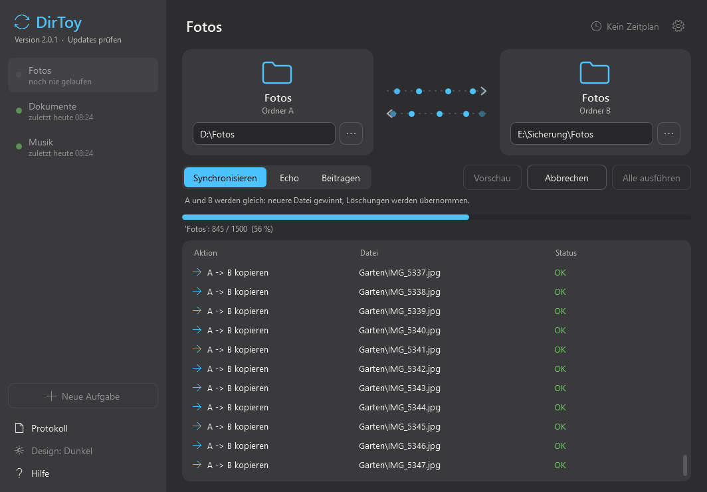
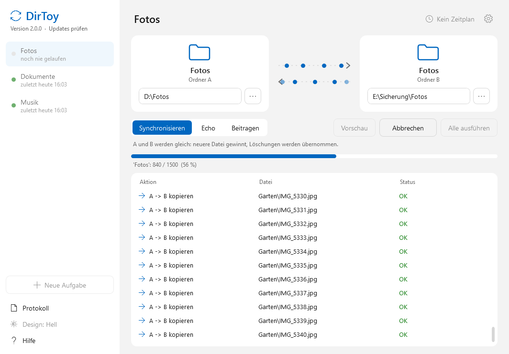

# DirToy

Grafisches Tool für Windows, das zwei Ordner synchron hält – inspiriert von SyncToy.
Geschrieben in PowerShell (WPF), ohne Installation lauffähig.

 

| Dunkel | Hell |
|---|---|
|  |  |

## Funktionen

- Beliebig viele **Sync-Aufgaben** mit je zwei Ordnern (A und B)
- **Drei Modi**: Synchronisieren (beidseitig), Echo (A → B, B wird wie A), Beitragen (A → B, ohne Löschen). Nach dem ersten Lauf liegt die Moduswahl hinter dem Zahnrad, damit sie nicht aus Versehen umgestellt wird
- **Ordner 1:1 identisch**: alle Unterordner werden rekursiv gespiegelt, auch leere; angelegt und (außer im Modus *Beitragen*) auch gelöscht
- **Sicheres Kopieren**: Dateien werden erst als Zwischendatei (`.dirtoy-tmp`) geschrieben und am Ende umbenannt – bei Abbruch oder Absturz bleibt das Original im Ziel unverändert. Mit **Abbrechen** stoppt ein Lauf nach der aktuellen Datei, auch beim Schließen des Fensters.
- **Ordnerbaum zum Abwählen**: beide Ordner nebeneinander als Baum, Haken entfernen = Ordner samt Unterordnern wird nicht synchronisiert. Neue Ordner sind standardmäßig dabei, gespeichert werden nur die abgewählten
- **Ausschlussfeld**: Dateinamen und Muster mit `;` getrennt, z. B. `Thumbs.db;*.tmp;node_modules`
- **Vorschau** zeigt, was passieren würde, ohne etwas zu verändern. Bei sehr vielen Aktionen (mehr als 2000) öffnet ein Doppelklick auf die letzte Zeile die komplette Liste als CSV-Datei (Excel: filtern, sortieren), die Summen je Aktion stehen schon in der Liste
- **Ergebnis-Fenster** nach jedem manuellen Lauf (wie bei SyncToy): Zusammenfassung je Aktion, Fehler, Dauer, Datenmenge und die einzelnen Aktionen, sortierbar per Klick auf den Spaltenkopf und kopierbar (Strg+C); komplette Liste als CSV. Auch die Liste im Hauptfenster lässt sich sortieren und kopieren
- **Animation zwischen den Ordnern** zeigt, in welche Richtung gerade gearbeitet wird. Der Lauf hat einen eigenen Thread, das Fenster bleibt dabei bedienbar
- **Fortschrittsbalken** und **Protokoll** (Liste im Fenster und `sync.log`)
- **Zeitpläne** direkt im Tool: legt Einträge im Windows-Aufgabenplaner an, ändert und entfernt sie. Auch Intervalle wie "täglich ab 08:00 alle 20 Minuten für 10 Stunden" (verpasste Intervalle werden nicht nachgeholt). DirToy prüft nach dem Anlegen, ob der Eintrag wirklich existiert; klappt es nicht (z. B. ohne Administratorrechte), zeigt es eine Anleitung zum manuellen Anlegen
- Windows-**Benachrichtigung** nach automatischen Läufen
- **Update-Hinweis**: DirToy sucht beim Start bei GitHub nach einem neueren Release (abschaltbar). Der Button "Update verfügbar" bietet "Jetzt aktualisieren" (lädt, prüft und ersetzt `DirToy.ps1`, die alte Datei bleibt als Sicherung) oder die Release-Seite im Browser. Ab 2.0 werden nur Updates mit gültiger Signatur des Entwicklers installiert
- **Hell- und Dunkel-Design**: automatisch wie Windows oder fest einstellbar (Button "Design")

## Voraussetzungen

Windows 10 oder 11 (Windows PowerShell 5.1 ist enthalten). Keine Installation nötig.

## Start

1. `DirToy.ps1` und `DirToy.cmd` in einen Ordner legen (`DirToy.ico` ist optional).
2. Doppelklick auf `DirToy.cmd`. Es ist eine einfache Textdatei mit einer Zeile und startet DirToy ohne dauerhaftes Konsolenfenster.

Das Programm-Icon ist in `DirToy.ps1` eingebaut (Fenster, Taskleiste, Benachrichtigung). Beim allerersten Start fragt DirToy, ob eine Verknüpfung mit Icon auf dem Desktop angelegt werden soll (später jederzeit über den Button **Desktop-Verknüpfung** im Hilfe-Fenster). Sie startet DirToy ganz ohne aufblitzendes Fenster (über `conhost.exe --headless`, ein Windows-Bordmittel). Beim Doppelklick auf `DirToy.cmd` blitzt dagegen kurz ein Fenster auf, das lässt sich bei Batch-Dateien nicht vermeiden.

Beim ersten Start wird der Ordner `DirToy-Daten` angelegt (Aufgaben, Zeitpläne, Protokoll). Darf DirToy neben dem Programm nicht schreiben (z. B. in `C:\Program Files` ohne Administratorrechte), legt es die Daten automatisch unter `%APPDATA%\DirToy` ab. Die automatische Update-Funktion ersetzt `DirToy.ps1` und braucht dort Schreibrechte; ohne sie über die Release-Seite aktualisieren.
Wurde die ZIP-Datei aus dem Internet geladen, ggf. vorher in den Dateieigenschaften "Zulassen" anhaken.
Die Skripte haben keine Windows-Signatur (Authenticode), Windows kann daher eine Warnung zeigen.

## Automatisch per Aufgabenplaner

Im Tool: Aufgabe wählen → **Zeitplan ...**. Mögliche Zeitpläne: täglich, wöchentlich, alle X Minuten, bei Anmeldung.
Die Aufgaben laufen im Hintergrund, solange man bei Windows angemeldet ist. Verpasste Läufe werden nachgeholt.
Auch von Hand startbar:

```
powershell.exe -NoProfile -ExecutionPolicy Bypass -WindowStyle Hidden -File "C:\Pfad\DirToy.ps1" -Task "Name der Aufgabe"
```

(`-All` führt alle Aufgaben aus.)

## ⚠️ Haftungsausschluss / Disclaimer

**DirToy kopiert, überschreibt und löscht Dateien.** Die Nutzung erfolgt **auf eigene Gefahr**.
Die Software wird **ohne jede Gewährleistung** bereitgestellt (siehe [LICENSE](LICENSE)); der Autor haftet nicht für Datenverlust oder sonstige Schäden.

Bitte unbedingt beachten:

- **Immer zuerst die Vorschau** benutzen, vor allem bei den Modi *Synchronisieren* und *Echo*.
- **Eine Datensicherung** der betroffenen Ordner anlegen, bevor eine neue Aufgabe zum ersten Mal läuft.
- Gelöscht wird in den **Papierkorb**, bei Netzlaufwerken ohne Papierkorb aber **endgültig**.
- Automatische Läufe fragen **nicht** vor dem Löschen nach.
- Lässt sich eine Datei nicht löschen (z. B. in Benutzung, Laufwerk nicht erreichbar), läuft DirToy ohne Rückfrage weiter, meldet den Fehler im Protokoll und versucht es beim nächsten Lauf erneut.

**English:** DirToy copies, overwrites and deletes files. Use at your own risk. Provided "as is" without warranty of any kind (see LICENSE). Always run the preview first and keep a backup.

## Entwicklung

Der Code liegt in `src\core` (Sync, ohne Oberfläche) und `src\gui`. `build.ps1` fügt alles zu `DirToy.ps1` zusammen, nur diese Datei wird ausgeliefert.
Tests in `tests\`: `test-kern.ps1`, `test-update.ps1` und `test-loeschen.ps1` laufen ohne Fenster, die Python-Tests bedienen das echte Fenster (dabei nicht tippen).
Release: Version in `src\core\01-start.ps1` setzen, `build.ps1`, `tools\signieren.ps1`, `DirToy.ps1` und `DirToy.ps1.sig` committen, Tag `vX.Y.Z` pushen.

## Lizenz

[MIT](LICENSE) – Nutzung, Änderung und Weitergabe sind erlaubt, auch kommerziell, solange der Lizenzhinweis erhalten bleibt.
